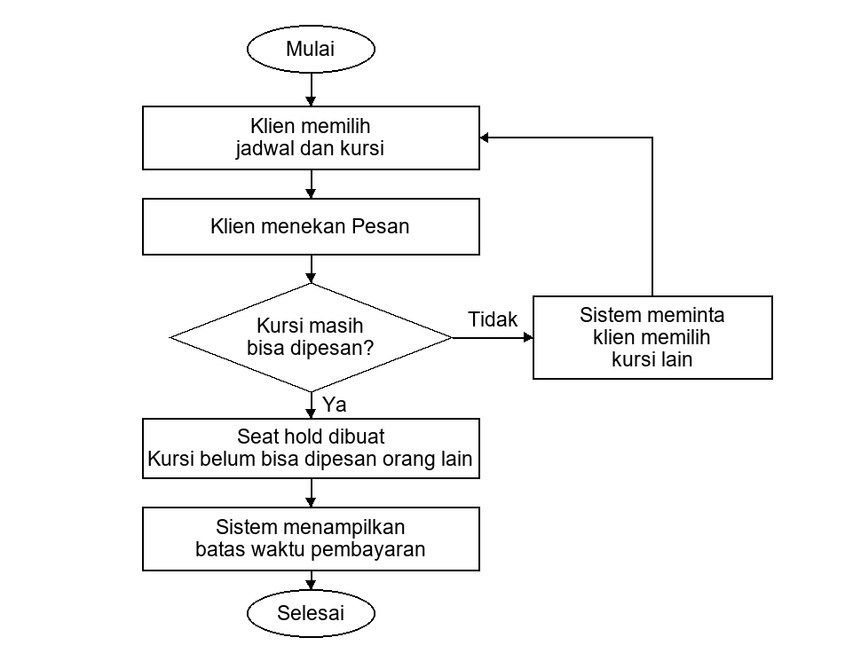
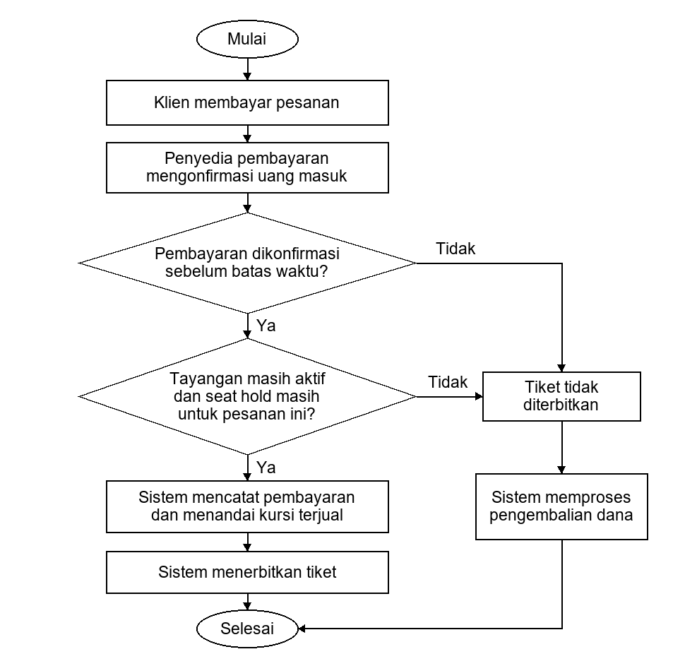
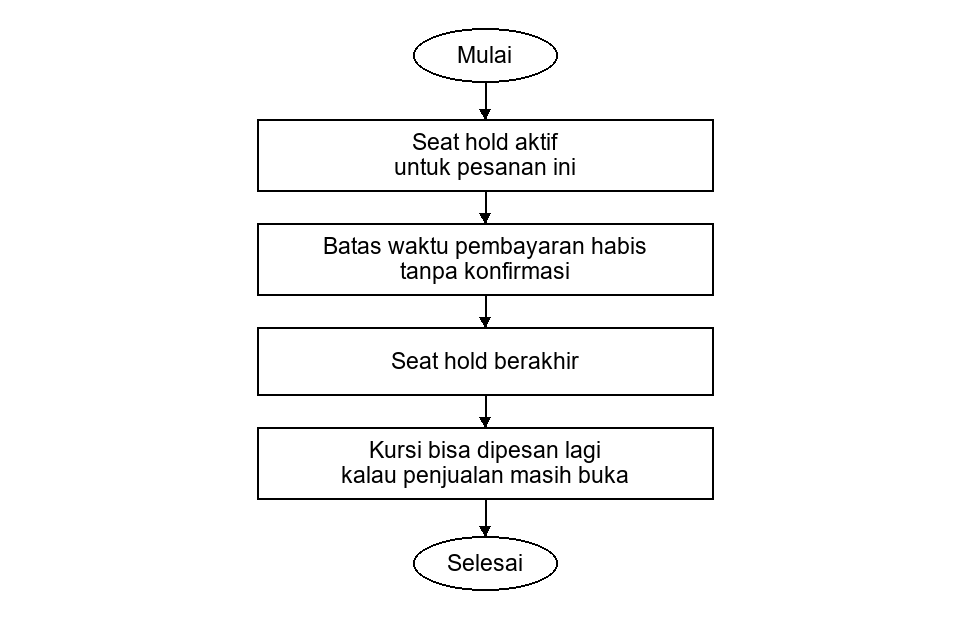
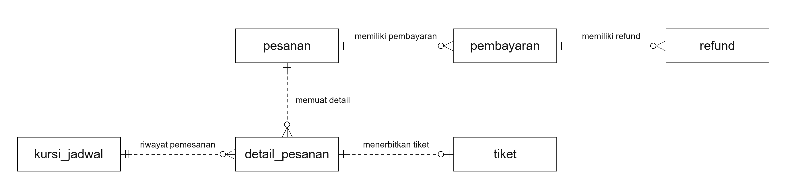
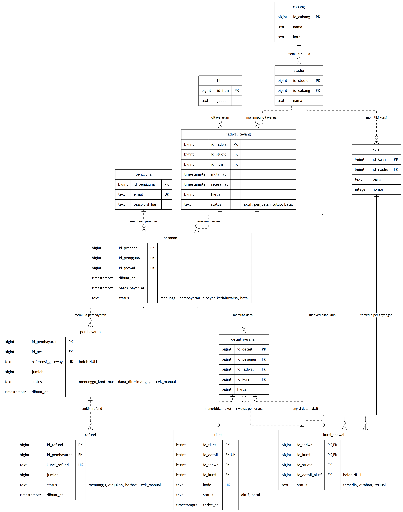

# Backend Engineer Skill Test — MKP

**Nama:** Hilmi Ra'if Avicenna

## A. System Design

### A.1 Flowchart pembelian tiket online

#### 1. Klien memilih jadwal dan kursi



#### 2. Klien membayar dan menerima tiket



#### 3. Klien tidak membayar sampai batas waktu



### A.2 Arsitektur sistem


#### Monitoring dan alert

Yang dipantau: waktu respons API, jumlah error 5xx, dan waktu tunggu lock di PostgreSQL. Untuk scheduler, cek kapan terakhir berhasil jalan dan berapa lama refund belum selesai. API dan scheduler juga mencatat timeout ke payment gateway. Tim tetap dapat notifikasi kalau scheduler berhenti atau refund terlalu lama, walaupun API masih jalan normal.

#### Pemilihan kursi saat trafik tinggi

Saat klien membuka daftar kursi, API hanya mengambil kursi dari jadwal yang dipilih. Jadi API tidak perlu membaca kursi dari tayangan lain.

Misalnya dua klien sama-sama melihat A7 kosong dan klik **Pesan** hampir bersamaan. API mengunci baris A7 di PostgreSQL dengan `SELECT ... FOR UPDATE` sebelum mengecek ulang ketersediaannya. Request pertama yang mendapat lock mencatat seat hold. Setelah transaksi selesai, request kedua baru bisa mengecek A7 dan melihat bahwa kursi itu sudah dipesan sementara. Kalau klien memilih beberapa kursi, pesanannya hanya berhasil kalau semua kursi tersedia.

Lock database dilepas begitu transaksi selesai. Seat hold tetap berlaku sampai batas bayar.

Kalau load test menunjukkan waktu tunggu lock di PostgreSQL meningkat karena banyak request berebut kursi yang sama, Redis bisa dipakai sebagai distributed lock. Kalau lock sedang dipegang request lain, API bisa langsung meminta klien mencoba lagi tanpa mengakses PostgreSQL. Request yang mendapat lock lanjut mengecek ketersediaan di PostgreSQL dan mencatat seat hold beserta batas bayarnya jika kursi masih tersedia.

#### Kalau query film dan jadwal mulai berat

API hanya mengambil jadwal dari cabang yang dipilih klien. Saat load test, waktu respons API dan beban baca PostgreSQL dipantau untuk melihat apakah query daftar film dan jadwal jadi bottleneck. Kalau query yang sama sering berulang dan membebani database, hasilnya bisa disimpan di Redis dengan TTL singkat. Read replica baru dipertimbangkan kalau beban baca masih tinggi setelah caching.

Proses yang butuh data terbaru, seperti menampilkan daftar kursi dan mengecek status kursi saat pemesanan, langsung baca dari database utama (primary). Read replica hanya untuk daftar film dan jadwal karena data tersebut masih aman ditampilkan walaupun pembaruannya terlambat sedikit.

#### Pembuatan dan konfirmasi pembayaran

Setelah transaksi untuk seat hold selesai, API Go membuat transaksi di payment gateway. API menyimpan referensi pembayaran dan mengirim link atau instruksi bayar ke klien. Scheduler mengecek pembayaran yang belum dikonfirmasi dan mengajukan refund.

Payment gateway mengirim callback ke API Go lewat load balancer. API memverifikasi callback, lalu mencari pembayaran dari referensi transaksi yang sudah disimpan.

Potongan ERD ini menunjukkan kaitan antara kursi yang dipesan, tiket, dan pembayaran:



Refund dicatat untuk pembayaran, bukan untuk tiket. Jadi dana yang masuk setelah batas bayar tetap bisa dikembalikan meski tiket belum terbit.

**Edge case ketika dana masuk setelah seat hold kursi A7 habis**

| Waktu | Yang terjadi | Siapa yang memegang kursi A7? |
| --- | --- | --- |
| Sebelum 13.10 | Klien pertama memesan kursi A7 lewat pesanan `P101` (referensi pembayaran `PAY101`). Seat hold berlaku sampai 13.10. | Pesanan `P101` |
| Setelah 13.10, sebelum 13.11 | Seat hold pesanan `P101` habis. Klien kedua memesan kursi A7 lewat pesanan `P102`. | Pesanan `P102` |
| 13.11 | Gateway mengonfirmasi pembayaran dengan referensi `PAY101` untuk pesanan `P101`. Tiket tidak terbit dan dana masuk proses refund. | Tetap pesanan `P102` |

Saat callback dari payment gateway masuk, API memakai referensi pembayaran `PAY101` untuk mencari pesanan `P101`, bukan nomor kursi A7. Dalam transaksi PostgreSQL, API cek apakah pesanan masih menunggu pembayaran, batas bayar belum lewat, tayangan masih aktif, dan semua kursi masih dipegang pesanan itu. Tiket baru terbit kalau semua cek lolos. Di contoh ini, batas bayar pesanan `P101` sudah lewat, jadi tiket tidak terbit dan dana masuk proses refund. Kursi A7 tetap dipegang pesanan `P102`.

#### Fungsi scheduler

1. **Cek pembayaran.** Kalau batas bayar sudah lewat tapi pembayaran masih `menunggu konfirmasi`, scheduler mengecek statusnya lewat API payment gateway. Hasilnya diproses dengan aturan yang sama seperti callback. Kalau pengecekan timeout, scheduler menjadwalkan cek ulang dengan jeda yang makin panjang (*backoff*). Kalau batas percobaan habis, pembayaran ditandai untuk dicek petugas. Callback yang valid tetap bisa diproses kalau masuk belakangan. Kalau callback dan scheduler sama-sama mengonfirmasi pembayaran yang terlambat, sistem hanya mencatat satu refund penuh untuk pembayaran itu.
2. **Kirim refund.** Scheduler mengambil refund `menunggu` dari PostgreSQL setelah transaksi yang mencatatnya selesai, lalu mengajukannya lewat API payment gateway. Kalau ada banyak refund, scheduler mengambilnya bertahap. Setelah gateway menerima pengajuan, status refund jadi `diajukan`. Statusnya baru jadi `berhasil` setelah pengembalian dana dikonfirmasi oleh penyedia pembayaran.

   **Kalau pengajuan refund timeout:** Gateway bisa saja sudah menerima pengajuan, tapi responsnya tidak sampai. Kalau gateway mendukung idempotensi, scheduler mengulang pengajuan dengan kunci yang sama supaya tidak membuat refund kedua. Kalau status pengajuan tidak bisa dipastikan lewat API dan retry tidak aman, scheduler berhenti mengulang. Sebelum mengajukan ulang, petugas cek di dashboard gateway apakah pengajuan sebelumnya sudah tercatat.

#### Restok tiket yang sudah terjual

Sebelum dibatalkan, tiket untuk kursi A7 berstatus `aktif` dan kursinya `terjual`. Saat bioskop membatalkan tiket itu, API melakukan row locking pada jadwal terkait dengan `SELECT ... FROM jadwal_tayang WHERE id_jadwal = $1 FOR UPDATE`. API lalu mengecek apakah penjualan masih buka, mengubah status tiket dari `aktif` menjadi `batal`, dan membuat catatan refund dengan status `menunggu`.

API hanya mengubah kursi A7 dari `terjual` menjadi `tersedia` kalau status tiketnya berubah dari `aktif` menjadi `batal` dalam transaksi itu, tayangan masih aktif, dan penjualan masih buka. Pembatalan tiket bersifat idempoten. Kalau permintaan yang sama dikirim ulang, tiket sudah `batal`, jadi API tidak melepas kursi atau membuat catatan refund lagi.

Pembatalan tiket, pencatatan refund, dan restok kursi (kalau memenuhi syarat) dilakukan dalam satu transaksi. Tiket lama tetap tersimpan dengan status `batal`.

#### Kalau bioskop membatalkan seluruh tayangan

Saat petugas membatalkan tayangan, API mengubah status jadwal menjadi `batal`. Setiap kali klien memesan kursi, API mengecek status jadwal di PostgreSQL sebelum membuat seat hold. Pesanan baru ditolak kalau jadwal sudah tidak `aktif`, meskipun di layar klien kursinya masih terlihat kosong.

API mengunci baris jadwal saat mencatat seat hold, menerbitkan tiket, atau membatalkan tayangan. Kalau pembatalan lebih dulu, API tidak membuat seat hold atau menerbitkan tiket. Kalau pemesanan lebih dulu, pembatalan menunggu sampai transaksi itu selesai. Lock hanya berlaku selama transaksi database, bukan selama pelanggan membayar.

Semua tiket yang sudah terbit untuk tayangan itu dibatalkan dan kursinya tidak dijual lagi. Untuk pembayaran yang sudah masuk, sistem membuat catatan refund dengan status `menunggu`. Scheduler lalu mengajukannya ke payment gateway.

## B. Database Design



[Buka ERD](docs/05-erd-bioskop.png) · [Skema PostgreSQL](migrations/001_init.sql)

Di tabel `kursi_jadwal`, `PRIMARY KEY (id_jadwal, id_kursi)` memastikan satu baris per kursi per tayangan. Di tabel `tiket`, indeks unik hanya berlaku pada tiket `aktif`, jadi satu kursi tidak bisa punya dua tiket aktif untuk tayangan yang sama.

## C. API Login dan Jadwal Tayang

| Method | Endpoint | Fungsi | Contoh respons |
| --- | --- | --- | --- |
| POST | `/login` | Login untuk mendapat token yang berlaku satu jam. Kirim token lewat header `Authorization: Bearer <token>` di semua endpoint jadwal. | `200 OK` · `{"access_token":"<token>"}` |
| POST | `/jadwal-tayang` | Buat jadwal. `selesai_at` harus setelah `mulai_at`. | `201 Created` · `{"id_jadwal":1,"id_studio":1,"id_film":1,"mulai_at":"2026-12-01T07:00:00Z","selesai_at":"2026-12-01T09:00:00Z","harga":50000,"status":"aktif"}`. Header `Location: /jadwal-tayang/1`. |
| GET | `/jadwal-tayang?page=1&limit=20` | Daftar jadwal, maksimal 100 per halaman. Parameter tidak valid menghasilkan `400 Bad Request`. | `200 OK` · `{"data":[],"meta":{"page":1,"limit":20,"has_next":false}}` |
| GET | `/jadwal-tayang/:id` | Detail jadwal | `200 OK` · `{"id_jadwal":1,"id_studio":1,"id_film":1,"mulai_at":"2026-12-01T07:00:00Z","selesai_at":"2026-12-01T09:00:00Z","harga":50000,"status":"aktif"}` |
| PUT | `/jadwal-tayang/:id` | Ubah semua data jadwal. `selesai_at` harus setelah `mulai_at`. | `200 OK` · Objek jadwal setelah diubah, formatnya sama seperti respons detail. |
| DELETE | `/jadwal-tayang/:id` | Hapus jadwal yang tidak dipakai data lain. Tidak menjalankan pembatalan atau refund. | `204 No Content` · Tanpa body, atau `409 Conflict` jika jadwal masih dipakai |

### Menjalankan API secara lokal

Perlu Go 1.23.1 atau lebih baru dan PostgreSQL. Buat database lalu impor skema:

```sh
createdb mkp_bioskop
psql -X -v ON_ERROR_STOP=1 -d mkp_bioskop -f migrations/001_init.sql
```

Salin [`.env.example`](.env.example) ke `.env`. Isi `DATABASE_URL` dan `JWT_SECRET` dengan nilai acak minimal 32 byte. Seed dan API membaca `.env` dari root project; variabel terminal yang sudah diatur tetap dipakai.

Jalankan seed untuk membuat data contoh, lalu nyalakan API:

```sh
go run ./scripts/seed.go
go run ./cmd/api
```

Impor [koleksi Postman](postman/MKP.postman_collection.json). Isi `id_studio` dan `id_film` dari keluaran seed, lalu jalankan request Login. Server memakai `http://127.0.0.1:8081` secara default; koleksi menyimpan token dan ID jadwal setelah request dijalankan. Akun demo lokal: `demo@example.com` / `mkp-demo-password`.
